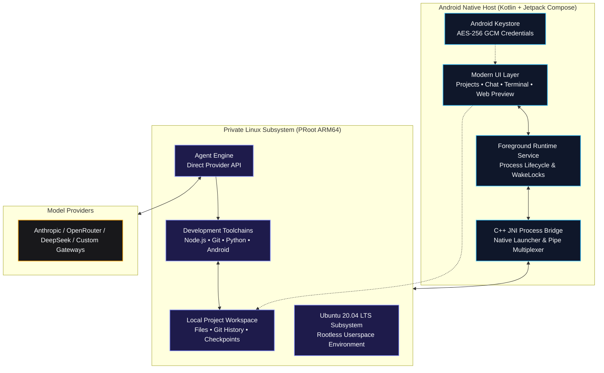

<div align="center">

  # Hermobile

  ### *The on-device AI app builder for Android.*

  **Create projects, chat with coding agents, edit files, run Linux commands, and build Android apps — all directly on your phone. No root required.**

  <br />

  [](https://github.com/mattpx/Hermobile/releases/tag/hermobile-v1.0.7)
  [](#system-requirements)
  [](#system-requirements)
  [](LICENSE)

  <br />

  [**Download APK**](https://github.com/mattpx/Hermobile/releases/tag/hermobile-v1.0.7) &nbsp;•&nbsp;
  [**Quickstart Guide**](#quickstart) &nbsp;•&nbsp;
  [**How It Works**](#how-it-works) &nbsp;•&nbsp;
  [**Build from Source**](#developer-guides)

</div>

<br />

---

<br />

> [!IMPORTANT]
> **Environment Security Notice**
> Hermobile runs on **ARM64 Android devices** using a private userspace PRoot layer. While isolated from other apps via standard Android sandbox permissions, PRoot is not a virtualization boundary or hardened security jail. Only execute projects and dependencies you own or trust.

<br />

## Download Hermobile

Download the latest signed release APK from [GitHub Releases](https://github.com/mattpx/Hermobile/releases/latest).

```text
Target Architecture : ARM64 (arm64-v8a)
Package             : com.hermobile.app
Package Version     : v1.0.7
Minimum OS Level    : Android 9.0 (API 28)
```

<br />

## How It Works

Hermobile is an **on-device AI app builder**: it unites a modern **Jetpack Compose UI** with a self-contained **Ubuntu 20.04 LTS subsystem** running inside PRoot. It gives you a desktop-class software development environment in your pocket without requiring root access, unlocked bootloaders, or external applications like Termux.

**Projects.** Create persistent projects or launch an instant Quick Project. Each project keeps its files, chat history, and task context together so work continues across app sessions.

**Agents via direct provider API (phase 1).** Chat with a coding agent that calls your configured model provider's API directly — Anthropic, OpenRouter, DeepSeek, Kimi, or a custom Anthropic-compatible endpoint. The agent inspects files, drafts code, and runs builds with visible tool activity and resumable project conversations. API keys are encrypted with Android Keystore-backed AES-256-GCM; prompts go straight from your device to the provider you chose, with no intermediate relays.

**Workspace: chat, files, terminal, preview.** The AI workspace combines streaming chat, a collapsible file browser with diffs and checkpoints, project-scoped and global Linux terminals (Node.js, npm, Git, and shell tooling included), and a browser-style preview for local web servers — spin up a Vite, Next.js, or Express server and test it in real time.

**Android builds.** Select the Android toolchain during onboarding and Hermobile installs a complete build environment into its private Ubuntu runtime. Build projects with the workspace play button: the resulting debug APK is passed directly to Android's system package installer and launched after installation. No USB debugging, wireless ADB pairing, port, or pairing code is required — Android still asks you to allow installs from Hermobile and confirm each installation.

<br />

## Workspace Interface

| Projects | Terminal | Settings |
| :---: | :---: | :---: |
| Create, organize, and resume isolated workspace sessions. | Execute real Linux commands and scripts with instant output. | Manage AI providers, installed toolchains, themes, and runtime health. |

<br />

## Quickstart

Get up and running in 3 guided steps:

### 1. Download & Install

Download the latest APK from [GitHub Releases](https://github.com/mattpx/Hermobile/releases/latest) and install it on an ARM64 phone running Android 9+.

### 2. Guided Bootstrap (~10 Minutes)

Launch the app and follow the interactive setup wizard:

1. **System Readiness** — verifies device storage, CPU architecture, and background service permissions.
2. **Toolchains** — select the core Ubuntu runtime and optional development stacks (including Android).
3. **AI Provider** — securely store your API key in Android Keystore and pick a model.

### 3. Create & Build

1. Tap **New Project** or launch an instant **Quick Project**.
2. Open the **AI Workspace** and describe what you want to build.
3. Watch the agent inspect files, draft code, run builds, and launch local web previews.

<br />

## Model Providers

Hermobile connects your device directly to your chosen AI endpoint using an Anthropic-compatible API protocol — official endpoints or compatible gateways:

| Provider | Integration Type | Streaming | Tool Calling | Status |
| :--- | :---: | :---: | :---: | :--- |
| **Anthropic API** | Direct Key | Supported | Supported | `Recommended` |
| **OpenRouter** | Gateway | Supported | Supported | `Supported` |
| **DeepSeek** | Direct Key | Supported | Supported | `Supported` |
| **Kimi** | Direct Key | Supported | Supported | `Supported` |
| **Custom API** | Endpoint Override | Compatible | Compatible | `Experimental` |

> [!NOTE]
> API keys are stored with hardware-backed Android Keystore AES-256-GCM encryption. No telemetry, no remote proxies, and zero plain-text leaks.

<br />

## Architecture

Hermobile bridges native Android Jetpack Compose to an isolated PRoot Linux execution layer via an optimized C++ JNI bridge:



### Core Runtime Components

* **Base Environment**: Ubuntu 20.04 ARM64 verified rootfs
* **Agent Engine**: Direct provider-API coding agent with isolated settings and resumable conversations
* **Native Tooling**: Node.js LTS, npm, Git, OpenSSL, curl, and GNU coreutils
* **Process Virtualization**: PRoot user-space architecture emulation with zero kernel modifications

<br />

## System Requirements

| Metric | Minimum Specification | Recommended Specification |
| :--- | :--- | :--- |
| **Operating System** | Android 9.0 (API level 28) | Android 13.0+ (API level 33+) |
| **CPU Architecture** | 64-bit ARM (`arm64-v8a`) | High-performance 8-Core ARM64 (Snapdragon 8 Gen 1+ / Dimensity) |
| **RAM** | 4 GB | 8 GB or more |
| **Free Storage** | 2.5 GB (Base Runtime) | 8.0 GB+ (For multi-language toolchains and build caches) |
| **Network** | Stable connection for setup & API | High-speed Wi-Fi during initial rootfs provisioning |

<br />

---

## Developer Guides

<details>
<summary><b>Building from source (Android Studio & NDK)</b></summary>

<br />

### Prerequisites

* **Android Studio**: Ladybug / Hedgehog or newer
* **Android SDK**: API Level 36 (`compileSdk 36`)
* **Java Development Kit**: JDK 17 (Eclipse Temurin or OpenJDK)
* **Android NDK**: `28.2.13676358`
* **CMake**: `3.22.1`

### Clone & Build Debug APK

```bash
# Clone the repository
git clone https://github.com/mattpx/Hermobile.git
cd Hermobile

# Build the standard ARM64 debug binary
./gradlew :app:assembleOnlineDebug

# Deploy directly to a connected test device
adb install -r app/build/outputs/apk/online/debug/app-online-debug.apk
```

### Quality Assurance & Testing

```bash
# Run unit tests
./gradlew testDebugUnitTest

# Run static analysis linter
./gradlew lintDebug
```

### Target Profiles

* **Direct Sideload APK** (Default): Targets API 28 to preserve proven userspace execution paths under Android 10-14.
* **Google Play Compliance Build**:
  ```bash
  ./gradlew -PplayBuild=true assembleDebug
  ```
  Refer to the [Google Play Release Checklist](docs/PLAY_STORE_CHECKLIST.md) for signing and permission policies.

</details>

<details>
<summary><b>Optional toolchains and development stacks</b></summary>

<br />

Hermobile allows downloading optional developer packs on demand to conserve space:

* **Python Suite**: Python 3.10+, pip, virtualenv, and essential scientific C-extensions.
* **Android & JVM**: OpenJDK 17 headless runtime and Gradle build tools.
* **C / C++ Compiler Suite**: GCC/G++, Clang, Make, and CMake for native tool compilation.
* **PHP Development**: PHP CLI runtime, Composer, and standard database extensions.

> *Note: Kernel-level virtualization technologies such as Docker, KVM, systemd services, and nested hardware emulators are not supported under PRoot.*

</details>

<details>
<summary><b>Repository directory structure</b></summary>

<br />

```text
Hermobile/
├── app/src/main/
│   ├── java/com/hermobile/app/
│   │   ├── data/       # Preferences, Keystore AES encryption, SQLite persistence
│   │   ├── model/      # Data entities: Projects, Chats, Files, Tool calls
│   │   ├── runtime/    # PRoot installer, C++ agent bridge, foreground services
│   │   └── ui/         # Jetpack Compose screens, Material 3 theme, ViewModels
│   ├── cpp/            # Native C++ launcher, pseudo-terminal pipe handler
│   ├── assets/         # Verified rootfs checksums, licenses, base configuration
│   └── res/            # Android icons, XML drawables, vector assets
├── fastlane/           # Play Store metadata, graphics, and release automation
└── docs/               # In-depth architectural notes & Play Store review guides
```

</details>

<details>
<summary><b>Security model and data privacy</b></summary>

<br />

* **Zero Cloud Intermediaries**: Hermobile connects your device directly to your chosen AI endpoint. No intermediate relays or telemetry servers collect your prompts or code.
* **Scoped Storage**: Project imports and exports utilize Android's official Storage Access Framework (SAF) instead of broad shared storage access.
* **Cryptographic Checksums**: Root filesystem archives and agent packages are verified via SHA-256 checksums prior to extraction.
* **Encrypted Secrets**: API tokens are encrypted in hardware-backed storage via Android Keystore.

- ARM64 phones only
- No hardened isolation for hostile code
- Terminal input/output currently uses a process bridge rather than a complete PTY emulator; full-screen interactive programs may render incorrectly
- Background tasks are subject to Android process and battery policies
- Custom providers may lack compatible thinking, tool use, token counting, or streaming behavior
- Large builds can be slow and memory-intensive under PRoot
- Runtime installation requires a substantial download and free storage
- Project-specific Android libraries may still be downloaded by Gradle when they are not already in the bundled Maven cache

Read our complete [Privacy Policy](PRIVACY.md).

</details>

Hermobile is currently intended for signed direct APK distribution and private testing. Its Android-project workflow requests permission to submit user-built APKs to Android's package installer, which requires a dedicated Google Play policy declaration and approval if distributed through Play.

<br />

## Current Limitations

* **Architecture**: Exclusively supports 64-bit ARM (`arm64-v8a`) hardware.
* **Process Isolation**: PRoot maps file systems and IDs in user space; it is not a cryptographically hardened container or VM.
* **Terminal Emulation**: The process bridge handles standard CLI workflows and REPLs; specialized ncurses applications may experience minor layout artifacts.
* **OS Process Management**: Heavy compilation workloads may be throttled if Android applies aggressive battery optimization. It is recommended to exempt Hermobile from battery optimization in device settings.

<br />

## Legal & Trademarks

* Hermobile is an independent open-source project and is not affiliated with, endorsed by, or sponsored by Anthropic.
* **Claude** and **Claude Code** are trademarks of Anthropic, PBC. Claude Code CLI is downloaded directly from Anthropic's official distribution endpoints during setup and remains governed by Anthropic's license terms.
* Ubuntu, Android, Kotlin, Node.js, Git, and other registered trademarks belong to their respective copyright holders.
* Third-party open-source licenses are compiled in [`app/src/main/assets/licenses`](app/src/main/assets/licenses).

<br />

## License

This project is licensed under the [MIT License](LICENSE). Third-party runtime binaries and packages remain governed by their respective upstream licenses.

<br />

---

<div align="center">
  <sub>Crafted for developers who want a serious, uncompromised development environment wherever they go.</sub>
</div>
